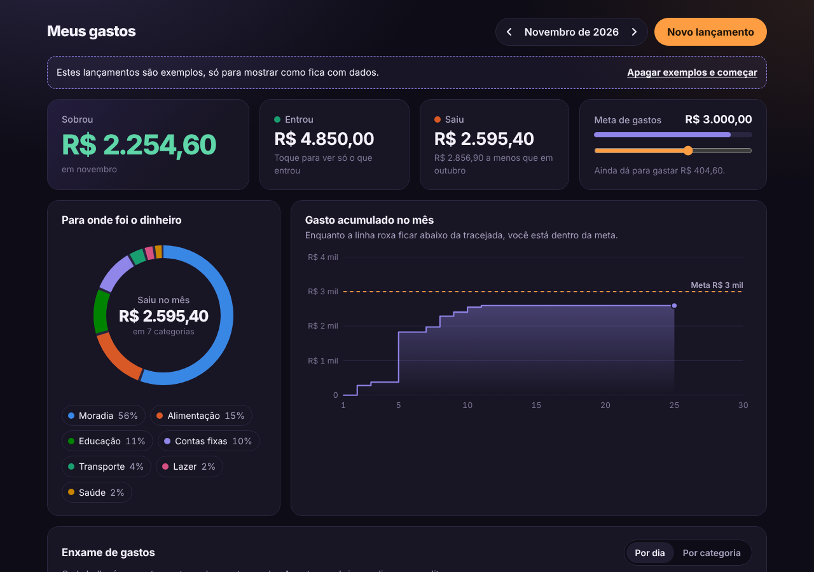

# Meus gastos


[](https://menguevtr.github.io/controle-de-gastos/)

**[Ver o painel online](https://menguevtr.github.io/controle-de-gastos/)**

Painel pessoal de gastos que roda no navegador. Sem cadastro, sem servidor e sem bibliotecas: HTML, CSS e JavaScript puros. Os lançamentos ficam guardados no `localStorage` do seu navegador.



## O que tem no painel

- **Resumo do mês**: quanto sobrou/faltou, quanto entrou/saiu e a meta de gastos.
- **Para onde foi o dinheiro**: rosca por categoria. Passe o mouse para destacar, clique para filtrar.
- **Gasto acumulado no mês**: a linha sobe a cada gasto e mostra a distância até a meta.
- **Enxame de gastos**: cada bolha é um gasto e o tamanho mostra o valor. Organize por dia ou por categoria, arraste as bolhas e clique para editar.
- **Últimos 6 meses**: entradas e saídas lado a lado. Clique em um mês para abri-lo.
- **Lançamentos**: lista por dia, com edição, exclusão e desfazer.
- **Backup**: baixe e restaure seus dados em um arquivo `.json`.

## Estrutura

```
controle-de-gastos/
├── index.html        Página e marcação do painel
├── css/
│   └── style.css     Tema escuro, grade e componentes
├── js/
│   ├── base.js       Constantes, utilitários, dados de exemplo e localStorage
│   ├── graficos.js   Rosca, gasto acumulado e últimos 6 meses (SVG)
│   ├── enxame.js     Gráfico de enxame com física (colisão, arrastar)
│   └── app.js        Tela: resumo, filtros, formulário e backup
├── README.md
└── .gitignore
```

Os scripts são carregados nessa ordem no fim do `index.html`. Não há etapa de build.

## Como rodar

```bash
git clone https://github.com/menguevtr/controle-de-gastos.git
cd controle-de-gastos
```

Abra o `index.html` no navegador. Se preferir um servidor local:

```bash
python3 -m http.server 8000
# depois abra http://localhost:8000
```

## Sobre os dados

Os lançamentos ficam só no navegador em que foram criados, e cada endereço tem o seu armazenamento. Para levar os dados do arquivo local para a versão publicada (ou para outro aparelho), use **Baixar backup** em um e **Restaurar backup** no outro.
